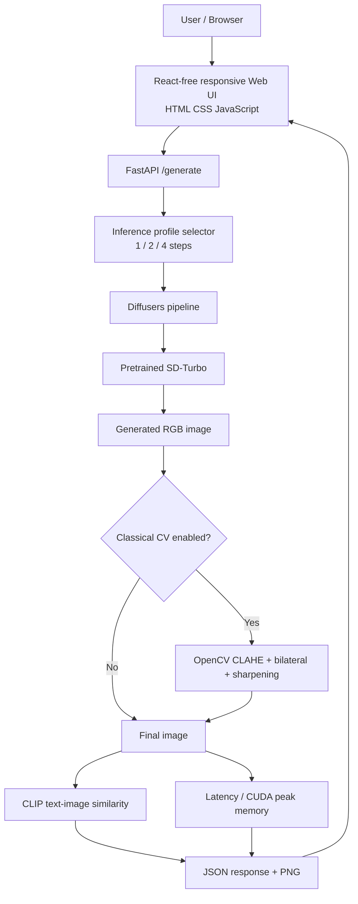

# VisionForge architecture

## Data flow
1. Browser submits prompt, mode, seed and post-processing flag.
2. API validates input and chooses denoising step budget.
3. Diffusers generates a 512×512 image using SD-Turbo.
4. Optional OpenCV post-processing is applied.
5. CLIP cosine similarity and runtime metrics are calculated.
6. API returns a PNG and metrics to the browser.
